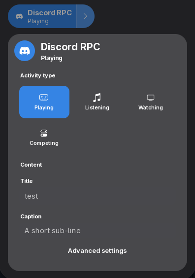
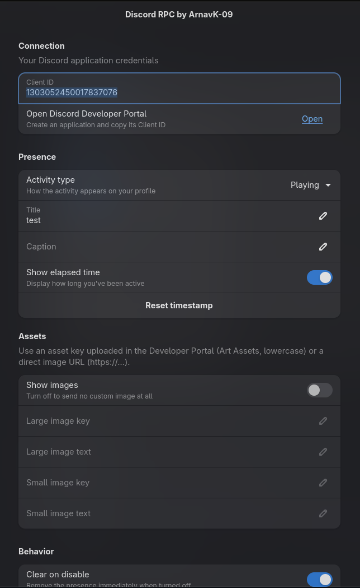

<h1 align="center">📝 Discord RPC 📝</h1>
<h2 align="center">Customize your Discord Rich Presence straight from quick settings</h2>

<p align="center">
    
</p>

> [!NOTE]
>
> **Discord RPC by ArnavK-09** is GNOME Shell extension that lets you customize and broadcast your Discord Rich Presence directly from the quick settings panel — pick an activity type, set a title & caption, toggle images and the elapsed timer, and turn broadcasting on/off with one click. Everything is event-driven and non-blocking: no background daemon, no polling loops, minimal resources, and it survives hard poweroffs cleanly.

## 🌟 Features

- **Quick-settings tile** – A native `QuickMenuToggle` with `toggleMode` so you flip broadcasting on/off right from the system menu; the arrow opens a compact popup.
- **Compact popup** – Activity type grid (Playing / Listening / Watching / Competing), editable Title (sent as `activity.name`, replacing the app name) and Caption (`activity.state`), and an "Advanced settings" button. GNOME theme colors + accent highlight, no custom palette.
- **Advanced preferences** – Adw-based window for Client ID, activity type, Title/Caption, Show elapsed time + Reset timestamp, Show images + large/small asset keys & hover text, Clear on disable, and Only show when Discord is open.
- **Only show when Discord is open** – Hides the tile unless a live Discord IPC socket is detected (event-driven `GFileMonitor` + async probe, no busy polling).
- **Crash-free & leak-free** – Every timer, signal, and monitor is torn down in `disable()`; async ops are guarded so they no-op after destroy.

## 💻 Installation

```bash
git clone https://github.com/ArnavK-09/discord-rpc-gnome-extension.git ~/.local/share/gnome-shell/extensions/discord-rpc-arnavk09@ArnavK-09 && cd ~/.local/share/gnome-shell/extensions/discord-rpc-arnavk09@ArnavK-09 && glib-compile-schemas schemas/ && gnome-extensions enable discord-rpc-arnavk09@ArnavK-09
```

pack into zip

```
zip -r discord-rpc-arnavk09@ArnavK-09.zip . -x "*.git*" -x ".github/*" -x "screenshots/*" -x "README.md" -x "package.json" -x "LICENSE" -x "*.ox*" -x ".gitignore" -x "node_modules/*" -x ".*"
```

Then log out and back in (or restart the Shell) so GNOME loads the extension, and set your **Client ID** in Preferences (from the Discord Developer Portal). Start Discord to broadcast.

## 🧩 Tech Stack

| Layer      | Technology                                                   |
| :--------- | :----------------------------------------------------------- |
| Runtime    | GJS (ES modules) inside GNOME Shell                          |
| UI (shell) | St, Clutter, GObject signals, `QuickSettings` API            |
| UI (prefs) | libadwaita (Adw), GTK4                                       |
| Settings   | GSettings / dconf (`org.gnome.shell.extensions.discord-rpc`) |
| Network    | Discord local RPC over Unix socket (`discord-ipc-{0..9}`)    |
| Tooling    | Bun, oxfmt, oxlint                                           |

## ⚙️ How It Works (behind the scenes)

> **Discord RPC** talks to the Discord desktop client over its **local IPC socket** (`$XDG_RUNTIME_DIR/discord-ipc-N`) — no gateway, no bot token, no external daemon.

1. **Connect** — `lib/discordIpc.js` opens the Unix socket with async `Gio.SocketClient.connect_async()` (non-blocking), tries each candidate path with a fresh cancellable, and performs the Discord RPC handshake (`op 0`, `{ v: 1, client_id }`).
2. **Handshake → READY** — on `op 1` `READY`, the IPC emits `connected`.
3. **Broadcast** — `lib/controller.js` builds the activity (`name`, `state`, `assets`, `timestamps`) and sends `SET_ACTIVITY` (`op 1`) frames as single-byte little-endian-header + JSON payloads via async `write_all_async`. Edits are debounced so typing doesn't flood Discord.
4. **React** — all preferences are GSettings keys; the controller observes `changed::key` and re-pushes instantly. The quick-settings tile binds `checked` ↔ `enabled`.
5. **Detect Discord** — `lib/watcher.js` uses an event-driven `GFileMonitor` + a 5s async probe to know whether Discord is running, so "Only show when Discord is open" hides the tile when it isn't.
6. **Clean lifecycle** — `disable()` disconnects every signal, removes every `GLib` source and monitor, and destroys all widgets; async ops are guarded by a `_destroyed`/`_openGen` generation flag so in-flight work aborts safely instead of touching freed objects.

## 📷 Screenshots

> Here's a working and expected screenshot of Discord RPC

<table>
  <tr>
    <td align="center"></td>
    <td align="center"></td>
  </tr>
  <tr>
    <td align="center"><sub>Quick settings tile — toggle broadcasting on/off</sub></td>
    <td align="center"><sub>Preferences — client ID, activity, assets, behavior</sub></td>
  </tr>
</table>

---

## 💻 Contributing

1. **Fork the Repository**  
   Click the **Fork** button at the top-right of the repo page.

2. **Clone Your Fork**  
   Clone the repo locally:

   ```bash
   git clone https://github.com/ArnavK-09/discord-rpc-gnome-extension.git
   ```

3. **Create a Branch**  
   Create a new branch for your changes:

   ```bash
   git checkout -b your-feature-branch
   ```

4. **Make Changes**  
   Implement your changes (bug fixes, features, etc.). Format & lint before committing:

   ```bash
   bun run format && bun run lint
   ```

5. **Commit and Push**  
   Commit your changes and push the branch:

   ```bash
   git commit -m "feat(scope): description"
   git push origin your-feature-branch
   ```

6. **Open a Pull Request**  
   Open a PR with a detailed description of your changes.

7. **Collaborate and Merge**  
   The mastertainers will review your PR, request changes if needed, and merge it once approved.

## 🙋‍♂️ Issues

Found a bug or need help? Please create an issue on the [GitHub repository](https://github.com/ArnavK-09/discord-rpc-gnome-extension/issues) with a detailed description.

## 👤 Author

<table>
  <tbody>
    <tr>
        <td align="center" valign="top" width="14.28%"><a href="https://github.com/ArnavK-09"></a><br /><a href="https://github.com/ArnavK-09"><h4><b>Arnav K</b></h3></a></td>
    </tr>
  </tbody>
</table>

---

<h2 align="center">📄 License</h2>

<p align="center">
<strong>Discord RPC</strong> is licensed under the <code>Unlicense</code> License. See the <a href="https://github.com/ArnavK-09/discord-rpc-gnome-extension/blob/master/LICENSE">LICENSE</a> file for more details.
</p>

---

<p align="center">
    <strong>🌟 If you find this project helpful, please give it a star on GitHub! 🌟</strong>
</p>
